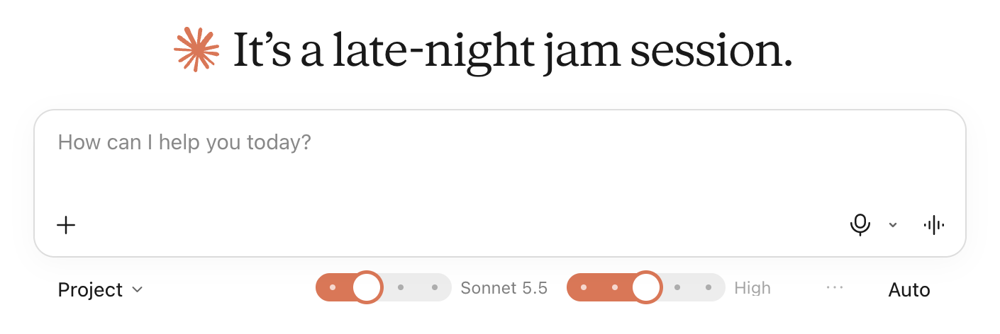

# Claude Slider

A Chrome extension that replaces the model dropdown on [claude.ai](https://claude.ai) with sliders. It works in chat and in Claude Code.

## Install

1. Download or clone this repository.
2. Open `chrome://extensions` and turn on **Developer mode**.
3. Click **Load unpacked** and choose this folder.
4. Reload any open claude.ai tabs.

After you pull an update, click the reload icon on the extension's card in `chrome://extensions`, then reload claude.ai.
